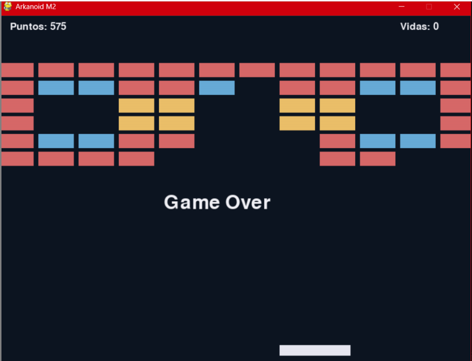
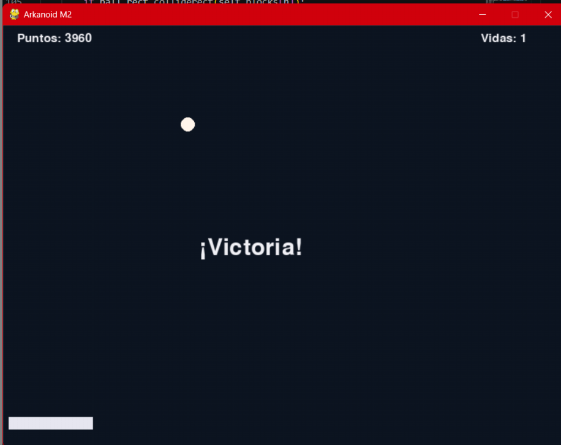
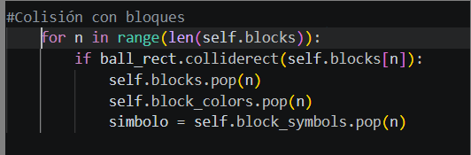
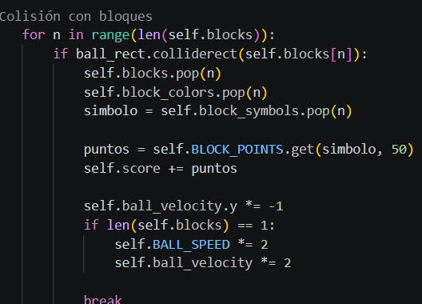

# Comprobaciones visibles de M2

Comprueba cada método antes de continuar con el siguiente:

- nivel válido y nivel inexistente;
- nivel con filas de distinta longitud;
- paleta en ambos límites de la pantalla;
- rebote contra pared, paleta y cada tipo de bloque;
- pérdida de una vida y reinicio de la bola;
- victoria al eliminar el último bloque y derrota al agotar vidas;
- salida limpia con Escape y al cerrar la ventana.

Una mejora opcional no debe romper ninguno de estos casos.

PRUEBA BÁSICA:

he decidido de duplicar la velocidad cuando quede un solo bloque para añadir dificultad
